# X0X

X0X turns the M-VAVE FM-1 into a groovebox: a 909, an 808, two 303s and a breakbeat player,
all playing at once, in stereo. Each part can play its own pattern, you can arrange patterns
into a song, record knob moves, and give single steps a sound and a chance of their own.

New in this version: see [What's new](https://charlesvestal.github.io/fm1-x0x/new/).

![A drawing of the FM-1 running X0X. On the left the knobs MASTER (volume), SELECT (page), PRESETS (pattern) and ALGORITHM (part), with OCT- and OCT+ below them (16 steps back and forward); the screen in the middle; on the right KNOB1 to KNOB4 (the page's four values) above two rows of buttons: FX (effects), SEL (list all), ENV (hold: accent), LFO (mixer), EDIT (sound), GLO (settings), then HOME (pattern, song), SAVE (save; hold: copy), ARP (TB-3PO), SEQ (steps), PLAY/STOP and REC (record). Below, the black keys (drum tracks, break slices, part mutes, mixer channels) and the white keys (steps; on HOME, patterns). Section 3 lists each control.](img/fm1-panel.svg "The FM-1 (a drawing), running X0X, each control labelled")

---

## Contents

1. Install
2. Getting started
3. Controls
4. The screen
5. 909 and 808
6. 303A and 303B
7. TB-3PO
8. Break
9. Patterns
10. Recording
11. Knob motion, p-locks and probability
12. Song
13. Effects
14. Mix and master
15. Settings and saving
16. MIDI and USB audio
17. Troubleshooting
18. Parameters
19. Credits

---

## 1. Install

**Try it first:** the [X0X emulator](https://charlesvestal.github.io/fm1-x0x/emu/) runs the same
code in the browser, with sound, played with the mouse, a touch screen or the keyboard.

**Install:** open the [web installer](https://charlesvestal.github.io/fm1-x0x/install/) in Chrome or
Edge, connect the FM-1 with a USB data cable and press Install. Don't unplug it while it's
writing; when it finishes, the FM-1 restarts into X0X.

**Update:** the same way. An update keeps your project: the patterns, sounds, song and settings.
Installing another firmware does not: it keeps its own things in the same memory, so coming back
to X0X starts with an empty project. To keep it, save it to a file first (see
[Back up your project](#back-up-your-project)).

**Go back:** "Back to the stock firmware", at the bottom of the same page, puts M-VAVE's firmware
back (download the FM-1 file from the link there, choose it, press the button; if the FM-1 doesn't
take it, use the V15 file from the second link). M-VAVE's own updater, M-UPGRADE, works too.

> Installing other firmware is at your own risk. If the FM-1 ever won't start, see
> [Recovering an FM-1 that won't start](#recovering-an-fm-1-that-won-t-start).

<details><summary>Install from the command line</summary>

Download the firmware file (for example `x0x-1.0.fwsc`) from the
[releases page](https://github.com/charlesvestal/fm1-x0x/releases), get the X0X source from GitHub,
install Python 3 with `pip3 install mido python-rtmidi`, and run:

```
python3 tools/fm1_install.py x0x-1.0.fwsc
```

(The web installer on hugelton.github.io installs Felucca, not X0X.)

</details>

---

## 2. Getting started

A five-minute tour, from switching on to saving your first beat. When X0X starts, the screen
shows the 909 and every part is empty.

1. **Add a kick.** Press black key 1 to pick the bass drum (you'll hear it), then press white
   keys 1, 5, 9 and 13.
2. **Press PLAY.** The kick plays on every beat.
3. **Add a clap.** Press black key 7, then white keys 5 and 13. While the pattern plays, picking
   a drum is silent, so you don't add a stray hit.
4. **Add open hats.** Press black key 9, then white keys 3, 7, 11 and 15.
5. **Write a 303 line.** Turn ALGORITHM two clicks clockwise to 303A and press ARP. Press OCT+:
   each press writes a new line. Keep going until you like one.
6. **Shape the 303.** Press EDIT. The knobs are now the 303's filter: KNOB 1 opens and closes it,
   KNOB 2 sets the resonance.
7. **Add the break.** Turn ALGORITHM two more clicks to BREAK and press all 16 white keys, so the
   break plays the whole bar.
8. **Mute a part.** Press HOME, then black key 5 to mute the break. Press it again to bring it
   back.
9. **Record a filter sweep.** Turn ALGORITHM back to 303A and press EDIT. Press REC, slowly turn
   KNOB 1 for a bar or two, then press REC again. The sweep now plays every time the pattern
   comes round.
10. **Save.** Press PLAY to stop, then SAVE. Everything is kept when you switch off. (X0X also
    saves by itself a few seconds after you stop; see section 15.)

Next: section 9 shows how to make more patterns and switch between them, and section 12 how to
arrange them into a song.

---

## 3. Controls

The drawing at the top of the manual names every control. In more detail:

A button that opens a screen always opens the same one; press it again for that screen's next
page. SEQ, EDIT and ARP show the part you choose with ALGORITHM.

| Control | What it does |
|---|---|
| MASTER | Volume. |
| SELECT | The previous or next page. In a list, up and down. Hold a step and turn it for the step's chance (section 11). |
| PRESETS | The next pattern: on a part's screen for that part only, on HOME for all five. |
| ALGORITHM | The part: 909, 808, 303A, 303B or BREAK. In a list, it changes the value. |
| OCT-, OCT+ | The steps, 16 at a time (1–16 … 49–64). On HOME and SONG, patterns 1–16 or 17–32. On the 303 keyboard, the octave. On TB-3PO, mutate the line or write a new one. |
| KNOB 1–4 | The four values at the bottom of the screen. Each click is one step, however quickly you turn a few; spin and they speed up. Hold ENV and turn one to put it back to its default. |
| FX | The reverb and the delay. |
| SEL | Everything on this screen as a list, including the settings on no page (see Lists). In a question, yes. |
| ENV | Hold while pressing keys: an accent. Hold and turn a knob: the knob goes back to its default. |
| LFO | The mixer and the master. Hold while pressing keys: a slide. |
| EDIT | The selected part's sound. The keys still write its steps. |
| GLO | The settings. Press again to close. |
| HOME | The pattern: all five parts, which pattern they play, mutes. Again: the song, and again back. In a list, back; in a question, no. |
| SAVE | Save everything (while playing: when you stop). Hold it to copy the pattern; then a white key pastes it. |
| ARP | TB-3PO, the 303 line generator (on a 303). |
| SEQ | The selected part's steps, with its LENGTH and RATE (on a 303 also DIRECTION and TRANSPOSE). |
| PLAY | Start and stop. |
| REC | Record on and off: drum hits, 303 notes, knob moves, and on the SONG screen the song. On a 303 the keys become a keyboard while it's on. |
| White keys | Steps. On HOME, patterns. On MASTER and FX they do nothing. |
| Black keys | Drum tracks, or the break's slices. On HOME they mute parts; on the mixer they pick a channel. |

**Hold HOME** for these: + REC undoes, + PLAY redoes, + SELECT sets the tempo, + SEQ tapped in
time taps the tempo, + a white key picks
a pattern from any screen, and + a black key mutes a drum track (on the 909 or 808 screen) or a
channel (on the mixer).

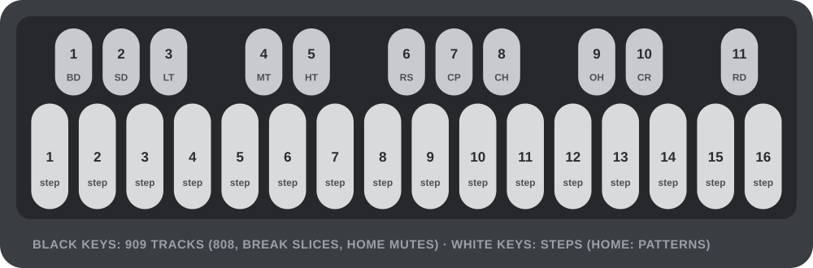

(The SEL button is labelled SCL in Felucca.)

### Lists

SEL turns the screen you're on into a list of everything on it: every knob from its pages,
grouped (on the 909, for example, BD: THIS TRACK and 909: ALL TRACKS), and then **MORE**, the
settings that are on no page. MORE is where the less used settings live, such as a drum
track's DRIVE and DIST or the compressor's details.

In a list, SELECT moves, ALGORITHM changes the highlighted value, and SEL runs a row with a
return arrow (an action). HOME goes back. X0X always asks before doing anything that would lose
notes: SEL for yes, HOME for no.

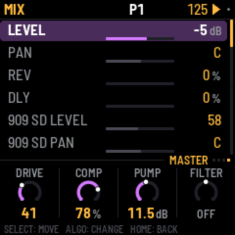
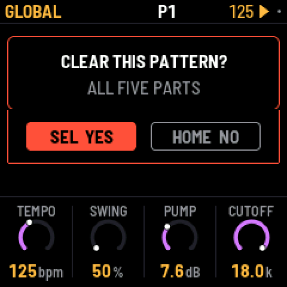

> **Not sure what a button does?** Hold it for a second on its own: a card says what it does on
> the screen you're on, with its combinations. Let go and nothing happens.

### Undo

Hold HOME and press REC to take back your last change; the screen says what it undid, for
example UNDO 909 P1. HOME + PLAY redoes it. You can go back up to 32 steps (fewer after very big
changes). A step is whatever you did before pausing for a moment: a few steps tapped in a row,
one turn of a knob, or a whole recording pass. Undo covers the sounds, patterns, song and knob
motion, even CLEAR PATTERN and FACTORY RESET, but not the tempo or the settings. The history is
cleared when you switch off.

<details><summary>What the key lights show</summary>

The key lights have two levels: bright for what is on or chosen, dim for what is there to
choose.

| Screen | Bright | Dim |
|---|---|---|
| HOME | the pattern playing (a cued one blinks); the parts playing | patterns with notes; muted parts |
| SONG | the bar's pattern; the bar's parts | patterns with notes; the bar's muted parts |
| 909 / 808 | the track's hits; the track | the other tracks with hits |
| 303 | notes | ties |
| 303 with REC on | the keys you hold | the Cs, to find your place |
| BREAK | the steps it plays | the slice pads 1–8 |
| Mixer (PARTS, 909 MIX, 808 MIX) | the channel the knobs set (blinking while muted) | the other channels |

</details>

---

## 4. The screen

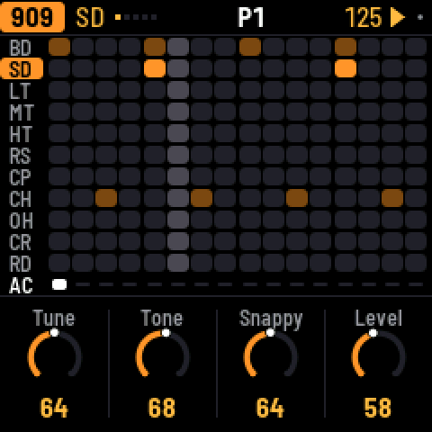

The **top line** shows, from left to right:

- the part, in its colour (909 orange, 808 red, 303A green, 303B blue, BREAK violet), and the
  screen if it isn't the sound: SEQ, TB-3PO, or KEYS while the 303 keyboard is on;
- the pattern playing, such as P3. P3 >5 means pattern 5 is coming up next. On a part longer
  than 16 steps, the steps the white keys show follow (33-48);
- the tempo, amber when X0X follows an external MIDI clock;
- a play symbol while playing and a red dot while recording. A small grey dot means there are
  unsaved changes.

When a button does something, the top line says what for a second, for example SAVED or P1
PASTED TO P5.

The **knobs** sit under a tag that says whose they are: the selected track (BD), the whole
machine (909 KIT), a 303's sound (303A TONE), the pattern (P3 SEQUENCE), the mixer (PARTS: 303A,
909 MIX: CP), a held 303 step on SEQ (303A STEP 5), or a p-lock (BD P-LOCK STEP 5). When a
section has more than one page the tag counts them (BD (1/2)), and the dots at the end of the
line are all the screen's pages, the current one lit. Settings with only a few choices show a
row of small squares instead of a ring.

When you turn a knob, its value shows in large type for a second, with whose it is: a track's
(BD TUNE) or a pattern's (P3 LENGTH). Settings that belong to the pattern change when the
pattern does, and are copied with it; the sound stays the same whatever pattern plays.

The **footer** at the very bottom says what the keys do on this screen (BLACK: TRACK, WHITE:
STEP). Until you first press a button it says HOLD ANY BUTTON: WHAT IT DOES.

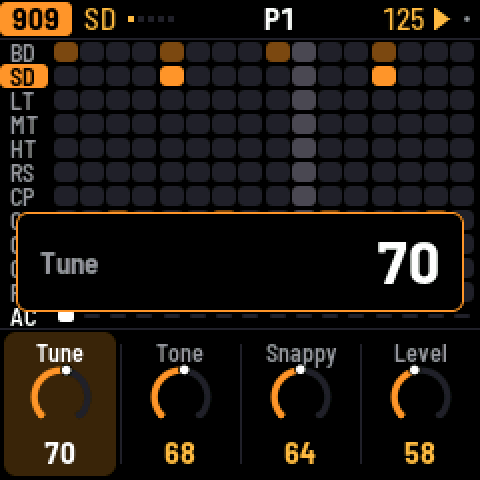

---

## 5. 909 and 808

Each drum machine has eleven tracks, one on each black key:

| Key | 909 | 808 |
|---|---|---|
| 1 | Bass drum (BD) | Bass drum (BD) |
| 2 | Snare (SD) | Snare (SD) |
| 3–5 | Low, mid and high tom | Low, mid and high tom, or congas |
| 6 | Rim shot (RS) | Rim shot, or claves |
| 7 | Clap (CP) | Clap, or maracas |
| 8 | Closed hat (CH) | Cowbell (CB) |
| 9 | Open hat (OH) | Cymbal (CY) |
| 10 | Crash (CR) | Open hat (OH) |
| 11 | Ride (RD) | Closed hat (CH) |

The 909's hats and cymbals are samples, as on the original machine; every other sound on both
machines is synthesized. On the 808, a track's SOUND setting switches it between tom and conga,
rim and claves, or clap and maracas. On both, the closed hat cuts off the open hat.

**Writing a beat.** Press a black key to pick a track; while the pattern is stopped you hear it
too. (While it plays, picking is silent so you don't add a stray hit; GLO > KEY SOUND = ALWAYS
changes that.) Then press white keys: an empty step turns on, and a tap on a step that's on
turns it off. Hold ENV while pressing white keys to place accents instead; an accent makes every
drum on that step louder.

A pattern can be up to 64 steps long. The white keys show 16 at a time: OCT+ moves to the next
16 and OCT- back, and the top line shows which 16 you're on.

**Muting a track:** hold HOME and press its black key; again to bring it back. A muted track's
row turns grey. Track mutes aren't saved, and muting the whole part on HOME leaves them as they
are.

**The pages.** EDIT shows the selected track's sound (one page, two for the 909's kick), then KIT
with ACCENT, how much louder accented steps are. A track's DRIVE and DIST are in SEL's list,
under MORE. SEQ has the machine's LENGTH and RATE. SWING is on HOME, because it swings every part.

Each track's level, pan and reverb and delay sends are on the mixer: press LFO and go to 909 MIX
or 808 MIX, which shows all eleven levels at once. The black keys pick a track and the knobs are
its LEVEL, PAN, REV and DLY. On the 808 the alternate sounds share their track's pan, so the
conga sits where the tom does.

---

## 6. 303A and 303B

There are two identical 303s. Each has its own sound and its own line.

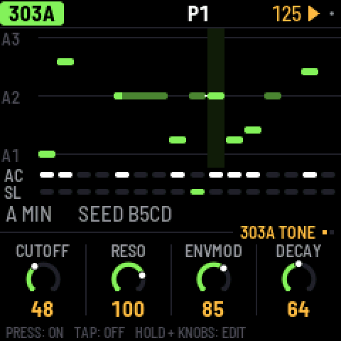

**Steps.** Press a white key to turn that step on; tap it again to turn it off. To edit a step,
press SEQ, hold the step's key and turn the knobs: KNOB 1 sets the note, KNOB 2 the gate (REST,
NOTE or TIE), KNOB 3 the accent and KNOB 4 the slide. OCT- and OCT+ move the held note an octave.
An empty step turns on as soon as you press it, so you can press, hold and set its note in one
go. A slide glides from this step's note into the next one. (Holding a step on EDIT gives it a
sound of its own instead: see P-locks in section 11.)

A **tie** holds the note before it through the step, so it doesn't play again. On the screen a
tied note joins the note it holds in one long bar. Turning KNOB 1 on a tie makes it a note of
its own.

**Keyboard.** Press REC and all 27 keys become a keyboard (KEYS shows on the top line). The
notes you play are written: step by step while the pattern is stopped, live while it plays.
OCT- and OCT+ change the octave. Play a key while still holding another and the 303 slides
between them. Press REC again to go back to steps.

**Free play.** To play the 303 without writing anything, press SEQ, turn SELECT to the KEYS page
and set FREE PLAY to ON. The keys then play the 303 on every 303 screen, stopped or playing, so
you can try lines and turn EDIT's knobs as you go; the top line says FREE PLAY. Nothing is
written until you press REC, which records as above. Set FREE PLAY back to OFF for the steps.
Each 303 has its own, and both are off at power-on.

**The pages.** EDIT has TONE (CUTOFF, RESO, ENVMOD, DECAY) and VOICE (ACCENT, WAVE, saw or
square, DRIVE, SLIDE time); TUNE, VOLUME, DRIVE TYPE (off, soft or RAT) and ACCENT DECAY are in
SEL's list. SEQ has the line's LENGTH (1–64 steps), RATE, DIRECTION (forward, reverse, ping-pong
or random) and TRANSPOSE. Each 303's level, pan and sends are on the mixer (LFO).

---

## 7. TB-3PO

TB-3PO writes 303 lines for you. Pick a 303 with ALGORITHM and press ARP.

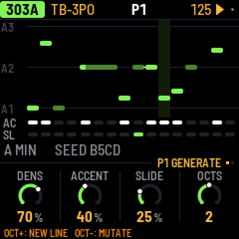

Press **OCT+** to write a completely new line, or **OCT-** to mutate the current one (about a
quarter of its steps change).

TB-3PO has two pages (press ARP again, or turn SELECT):

- GENERATE: DENS, ACCENT and SLIDE set how many steps play, are accented and slide. OCTS sets
  the range, from 1 to 3 octaves.
- SCALE: ROOT, SCALE (minor, Phrygian, harmonic minor, minor pentatonic, Dorian or major),
  OCTAVE, and MUTATE, which mutates the line by itself every 1–16 bars (or never).

These knobs don't change the line you're hearing. They set up the next OCT+ or OCT-, so your
line stays exactly as it is, hand edits included, until you press one. When the knobs no longer
match the line, the screen shows NEW LINE with a star. The same settings and seed always give
the same line, the same one Schwung's TB-3PO module writes.

To edit the line by hand, press SEQ; to shape its sound, EDIT.

---

## 8. Break

The break is a drum loop cut into eight slices, which X0X rearranges as it plays.

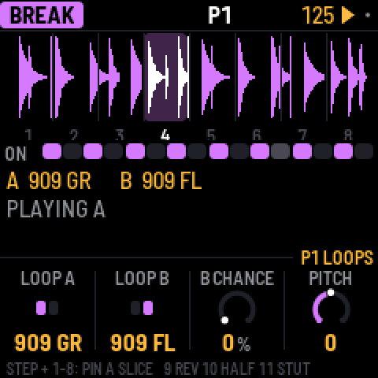

**Steps.** The white keys are the bar's 16 steps: press one to let the break play there, tap it
again to stop it.

**Playing slices.** Hold black keys 1–8 to play those slices yourself; let go and the generator
takes over again. Hold key 9 to play backwards, key 10 for half speed, key 11 to stutter.

**A step's own slice.** Hold a white key and press black key 1–8: that step now always plays
that slice of loop A, from its start, and its box shows the slice's number. Press the same black
key again (holding the step) to give it back to the generator. This way you can fix the kick and
snare where you want them and let the generator play with the rest.

**The generator.** SEQ has its two pages, GROOVE and RETRIG:

- COMPLEXITY: how often it jumps to a different slice instead of playing the next one. This is
  the amount: at 0 the loop plays straight, and ROLL and FILL come in with it, at full effect
  from 25%, so low settings stay close to the loop.
- ANCHOR: how strongly it keeps the kick and snare slices on beats 1 and 3.
- ROLL: how often it repeats a slice or moves to the one next to it.
- FILL: how much the last bar of a phrase breaks these rules.
- RETRIG 2X, 3X, 4X and 8X: the chance in each bar of stuttering a beat at that rate.

In SEL's list: PHRASE, the length of a phrase (2, 4, 8 or 16 bars, or off), and A LENGTH and B
LENGTH, how often a new slice is chosen (every 1/4 bar to every 8 bars).

**The loops.** EDIT has LOOP A, LOOP B, B CHANCE (the chance of switching to loop B in the last
bar of a phrase; with PHRASE off, in any bar) and PITCH. Press EDIT again for FILTER and LEVEL.
FILTER is one knob: OFF in the middle, turn it left for a low-pass, right for a high-pass. A
high-pass leaves a loop's hats and lets the 909 or 808 play the kick and snare. Loops follow the
tempo by playing faster or slower, so their pitch follows it too, as on a sampler; PITCH shifts it
on top. X0X comes with two loops of its own, 909 GR and 909 FL, played by its 909; loops you
upload come after them.

All of these, the steps, slices and loops, are saved with the pattern. The break's level, pan
and sends are on the mixer's PARTS page (LFO, black key 5).

### Your own breaks

Load your own loops with the [break loops page](https://charlesvestal.github.io/fm1-x0x/breaks/), in
Chrome or Edge with the FM-1 connected. They appear after X0X's own loops as BR1, BR2 and so on.
There's room for about 21 seconds in all: around nine one-bar loops.

<details><summary>From the command line</summary>

With the FM-1 connected, run:

```
python3 tools/upload_breaks.py --bars amen.wav think.wav funky.wav ...
```

`--bars` keeps one bar of each file; without it, each file is sent whole. This replaces all your
loops. `--dry-run FOLDER` shows what would fit without the FM-1. If you have schwung-breakbeat next
to X0X, `--bbgen` sends BB Gen's classic breaks. To build loops into the firmware itself, see
BUILDING.md.

</details>

---

## 9. Patterns

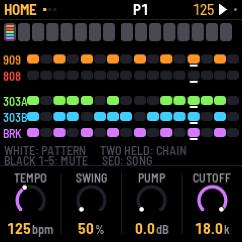

There are 32 patterns. A pattern holds each part's steps, length and rate, the break's settings,
the swing, and any knob motion, p-locks and probabilities. Sounds, effects and master settings
are not part of a pattern and don't change when the pattern does.

Each part plays its own pattern, so the 303s can play pattern 3 while the drums play pattern 7.

**HOME** shows patterns 1–16 as boxes, one per white key; OCT+ shows 17–32 (P17-32 appears under
the boxes) and OCT- goes back. Every fourth box is numbered. In each box, a line for each part
with notes in that pattern: bright where that part is playing it now, dim otherwise.

**Choosing patterns**

- **All five parts:** on HOME, press a white key or turn PRESETS. From any other screen, hold
  HOME and press a white key.
- **One part:** on that part's screen (SEQ, EDIT, TB-3PO), turn PRESETS.
- **A chain:** on HOME, hold two white keys at once. All five parts play each pattern from the
  first to the second, a bar each, then start again. Choosing a single pattern ends the chain.

While playing, the new pattern starts when the current bar ends; stopped, it takes over at once.
A part that changes pattern starts again from step 1; the others carry on.

**Copy and paste.** Hold SAVE: the top line says P1 COPIED. Press a white key to paste onto that
pattern (P1 PASTED TO P2): all five parts, as they're playing now. If the pattern you paste onto
has notes, X0X asks first. While holding SAVE, OCT- and OCT+ switch between patterns 1–16 and
17–32.

**Clearing.** Hold SAVE and press REC to clear the selected part in its pattern. GLO > CLEAR
PATTERN clears all five.

**Muting.** On HOME, black keys 1–5 mute and unmute the parts. Mutes aren't saved, except inside
a song.

**Lengths and swing.** Parts can have different lengths, so they drift against each other. The
909's length sets the length of a bar, and the 909's pattern holds the swing, which applies to
every part. Swing delays every second 16th note: 50% is straight, 75% the most.

HOME's knobs are for playing live: TEMPO, SWING, and the master's FILTER and PUMP.

**Tap tempo.** Hold HOME and tap SEQ in time with the beat, from any screen, playing or stopped.
From the third tap in a row it sets the tempo; keep tapping and it follows the last four. One or two
taps change nothing, so a stray press does no harm. A pause of two seconds starts over. While playing,
from the third tap on, each tap also puts the beat on your tap: every part jumps to the nearest quarter
note and plays on from there. A tap a little late goes back to
the beat just passed; a tap a little early skips ahead to the coming one, and just before the bar
line the bar ends on your tap, bringing in the next pattern or the song's next bar. The TEMPO readout shows the result. While X0X follows an external MIDI clock, the clock
sets the tempo and tapping does nothing.

---

## 10. Recording

Press REC to turn recording on, and again to turn it off.

- **Drums:** while the pattern plays, press black keys to record hits (with REC on you always
  hear them). Hold ENV for accented hits.
- **303, live:** with REC on, the 303's keys are a keyboard; play while the pattern runs.
- **303, step by step:** with REC on and the pattern stopped, each key you press fills the next
  step, from step 1. Hold ENV while pressing a key for an accent, or LFO for a slide. For a rest,
  hold ENV and press OCT- or OCT+; for a tie, hold LFO and press OCT- or OCT+.
- **Knob moves:** with REC on and the pattern playing, turn any sound knob (section 11).
- **The song:** REC + PLAY on the SONG screen (section 12).

---

## 11. Knob motion, p-locks and probability

All three give steps values of their own, and all three are saved with the pattern.

### Knob motion

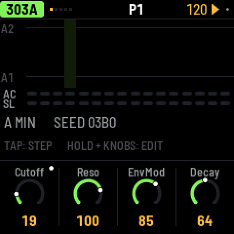

Turn on REC, press PLAY and turn any sound knob. X0X records the knob on the steps where you moved
it, fills in short pauses so a slow sweep has no gaps, and on playback glides from step to step.

- A knob with motion has a dot in its corner, and its ring follows the recording as it plays.
- On steps you didn't touch, the knob's own setting plays.
- Turning the knob without REC takes over for one pass of the pattern; then the recording plays
  again.
- **To clear a knob's motion,** hold SAVE and turn the knob.
- Motion belongs to a part's pattern: the 303's knobs record into the 303's pattern; the effects
  and master into the 909's. Copying or clearing a pattern copies or clears its motion too.
- When you stop, every knob goes back to its own setting.

### P-locks

A step can have a sound of its own: a higher tune on one kick, an open filter on one 303 note,
the break pitched up for one step.

- On EDIT, hold a step that's on and turn a sound knob. That step plays the new value; the
  others keep the knob's. While you hold the step, the knob row says P-LOCK STEP 5, the knobs
  show the step's values, and an amber dot marks the locked ones. Stopped, you hear the lock
  while you hold the step.
- A tap still turns a step on or off: only a hold with a knob turn makes a lock. An empty step
  turns on as soon as you press it, so you can press, hold and lock in one go.
- **To clear one lock,** hold the step, hold SAVE and turn the knob.
- On SEQ, holding a step locks nothing (on a 303 the knobs set the step's note instead).

### Probability

Hold a step (on SEQ or EDIT) and turn SELECT to set the chance it plays, from 100% down to 5%
in steps of 5; the top line shows it (STEP 5: 50%). The dice are rolled every time the step comes
round, so 50% plays about every other pass.

Keep turning past 5% for **cycles**: 1:2, 2:2, 1:3 and so on up to 8:8. A step at 1:4 plays on the
first of every four times round its part's pattern, 2:4 on the second; nothing random about it.
Each part counts its own passes, from 1 again whenever you press PLAY or it changes pattern.

- On the 909 and 808 the chance belongs to the selected track's step, so the kick and the hats
  on one step can each have their own.
- On a 303 a skipped step is a rest; on the break, a skipped step doesn't fire.
- A skipped drum hit sends no MIDI note.

### Good to know

- Steps with p-locks or a chance below 100% have a small notch on the step grid.
- P-locks and probabilities are stored like recorded motion, one "knob" per locked setting per
  part pattern. There's room for 160 across all patterns; when it's full, the top line says
  MOTION FULL.
- Two locked steps next to each other glide from one value to the other, like a recording.

---

## 12. Song

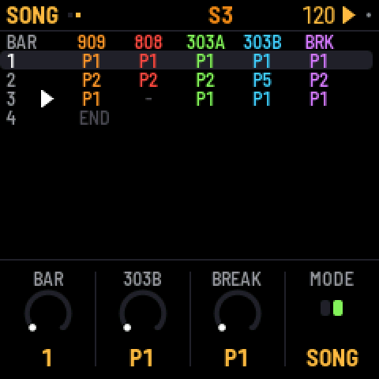

A song is a list of up to 192 bars. Each bar says which pattern each part plays and which
parts are muted. To open the song, press HOME twice (HOME again comes back to the pattern).

- **Write bars:** press a white key. The selected bar gets that pattern for all five parts,
  and the next bar is selected. Pressing keys at the end of the song adds new bars.
- **Edit a bar:** turn KNOB 1 to select the bar, then use the other knobs to set each part's
  pattern for that bar.
- **Mute parts in a bar:** press black keys 1–5.
- **Repeat a bar:** on the SONG screen's second page (turn SELECT), REPEAT plays the selected bar
  up to 8 times (x2 … x8 shows at the end of its row), so four bars of the same pattern are one
  row.
- **Play the song:** press PLAY on the SONG screen. The song starts at the selected bar and
  loops, and keeps playing wherever you go (HOME for mutes, EDIT for sounds) until you stop it.
  While it plays, the top line shows S and the current bar number. PLAY anywhere else plays the
  patterns: whatever screen you start from decides, and the top line says which (S or P).
- **Record the song:** on the SONG screen, turn on REC and press PLAY. As it plays, change patterns
  and mute parts however you like. Each bar is written into the song as it goes by, starting
  from the bar you started on, and the song grows if you play past its end. Recording
  replaces what was in those bars before.

Press SEL on the SONG screen for LENGTH, INSERT BAR, DELETE BAR and CLEAR SONG.

---

## 13. Effects

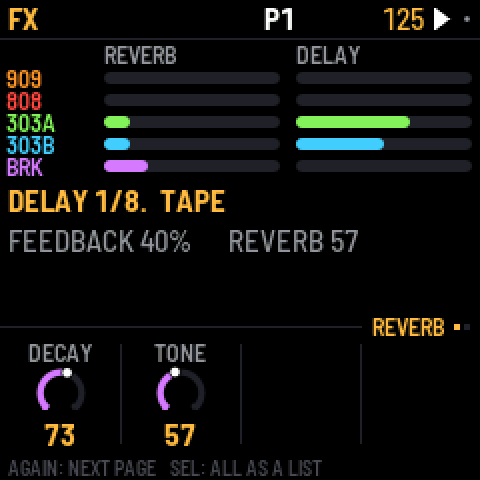

There is one reverb and one delay, and every part can send to both: each part's sends are on the
mixer's PARTS page (LFO), each drum track's on 909 MIX and 808 MIX. FX shows how much every part
sends, and has two pages:

- REVERB: DECAY and TONE. The reverb is a smooth stereo reverb: whatever you send it comes back wide.
- DELAY: TIME (in note values from 1/32 to a dotted half note), FEEDBACK, TONE and TAPE. TAPE at
  the far left (DIGI) is a clean 12-bit digital delay; turned up, it is a tape delay that wobbles,
  saturates and wears more the further you turn it, and can feed back on itself at high feedback.

In SEL's list, under MORE: each effect's low cut and return level, and PING WIDTH, which bounces the
echoes between left and right: 0 is off, 127 puts them hard left and right, and between, closer
together.

---

## 14. Mix and master

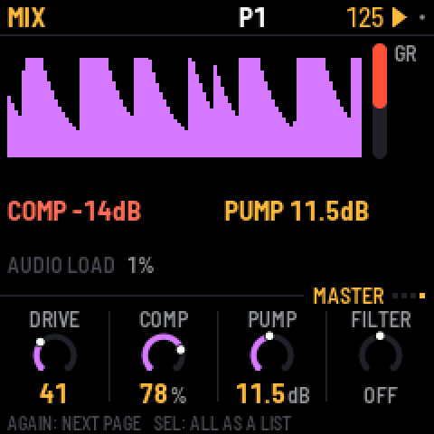

Press LFO to open the mixer; press it again (or turn SELECT) for its four pages. The red bar on
the right is the compressor's gain reduction.

- **PARTS**: a level and a meter for each part. Press black keys 1-5 to pick the 909, 808,
  303A, 303B or the break; the knobs are its LEVEL, PAN, REV and DLY.
- **909 MIX** and **808 MIX**: each drum machine's own mixer, every track's level at a glance;
  the black keys pick a track, and the knobs set its LEVEL, PAN, REV and DLY.
- **MASTER**: four knobs over the whole mix. The screen shows the output level over the last
  couple of seconds, so you can see the pump and the compressor working.

On PARTS, 909 MIX and 808 MIX, hold HOME and press a black key to mute or unmute that channel (a
part on PARTS, a track on the drum pages). The key lights show it: the channel the knobs set is
bright (blinking while muted), the others dim, muted ones dark.

Turning ALGORITHM on the mixer goes to that part's page: 909 MIX or 808 MIX for the drum
machines, PARTS (with the part picked) for the 303s and the break.

| MASTER | What it does |
|---|---|
| DRIVE | Saturates the whole mix (the 909's drive stage). |
| COMP | One knob for the compressor: 0 is off; turning up lowers its threshold, raises its ratio and adds makeup gain together. Three quarters is the factory's hard squeeze (4:1 from -24 dB, +16 dB). |
| PUMP | Lowers the whole mix each time the kick plays, by up to 24 dB, and lets it swell back up: the big-beat breathing. Accented kicks pump harder. It works even with COMP at 0, and even when the kick is muted, so a silent kick can drive it. Which kick: PUMP BY in SEL's list (the 909's, the 808's or both). |
| FILTER | One knob: in the middle it's off; to the left a low-pass closes down, to the right a high-pass opens up. |

FILTER and PUMP are also on HOME's PERFORM page, for playing live.

> **The factory mix is set up for big beat:** the break up front with the 909 kick under it, the
> 303s through RAT distortion into a tape delay, reverb on the clap. For a clean mix, set COMP and
> PUMP to 0.

<details><summary>The master in detail</summary>

In SEL's list, under MORE: the compressor's THRESH (-48 to 0 dB), RATIO (1:1 to
20:1 and INF), ATTACK (0.1 to 100 ms), RELEASE (10 to 1500 ms), MAKEUP (0 to 24 dB) and MIX (dry
to fully compressed, for parallel compression); PUMP BY (the 909's kick, the 808's, or both); the
filter's RESO; LIMIT, which prevents clipping (leave it on); and the drive stage's DIST type, its
GLUE compressor and VOLUME. Turning COMP or FILTER sets their details again.

</details>

---

## 15. Settings and saving

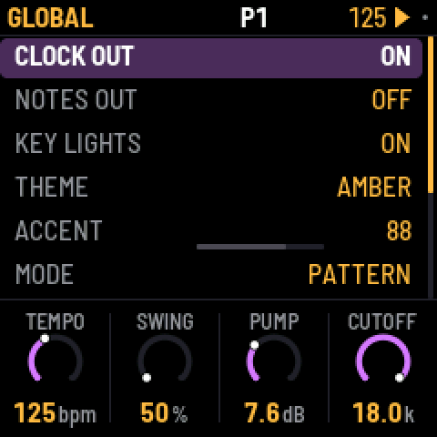

Press GLO for these settings, in five sections (MIDI, AUDIO, KEYS AND SCREEN, PROJECT, SYSTEM):

| Setting | What it does |
|---|---|
| CLOCK OUT | Sends MIDI clock and start/stop messages. |
| NOTES OUT | Sends the patterns out as MIDI notes. |
| 909 … BREAK MIDI CH | Each part's MIDI channel, for notes and CCs in and out: 1–16, or OFF to ignore incoming notes and CCs for that part (and send none). |
| CC OUT | OFF (the default): X0X sends no CCs. KNOBS: the knobs you turn go out as CCs. ALL: what knob motion and p-locks play goes out too. For details, see section 16. |
| MIX MIDI CH | The channel for the mixer's levels, the effects and the master: 1 (the default) to 16, or OFF. |
| OUTPUT | NORMAL, or LOUD: 6 dB more at the headphones and line out (and USB audio), for headphones that need it. The master's LIMIT (on by default) keeps it from clipping. |
| USB AUDIO | FOLLOWS KNOB (the default): USB audio is as loud as the FM-1, MASTER knob and all. FULL: USB audio stays at full level whatever the knob says, so you can record over the cable with the speaker turned down. |
| LIGHTS | ON: the key lights show the steps, and the unlit buttons glow dimly so they can be read. KEYS: the key lights only. OFF: neither. |
| KEY SOUND | STOPPED (the default): picking a drum or editing a 303 step is silent while the pattern plays, unless REC is on. ALWAYS: you always hear it. The 303 keyboard always plays either way. |
| THEME | The screen colour: green, amber, cyan, red or mono. |
| SAVE PROJECT | Saves everything. |
| AUTOSAVE | ON (the default): while the pattern is stopped, changes are saved by themselves once nothing has been touched for four seconds. OFF: only SAVE saves. |
| CLEAR PATTERN | Clears all five parts of the current pattern. |
| FACTORY RESET | Goes back to the factory sounds and empty patterns, with no song and no knob motion. Your saved project is kept until you save over it. |
| PERFORMANCE | Opens the performance page (below). |
| 2ND CORE | ON (the default): X0X uses both of the FM-1's processor cores. OFF: one core. Takes effect the next time you switch on. X0X sets it to OFF by itself if it crashes with two cores (see the performance page, below). |
| ABOUT X0X | Shows the version, how full the memory for patterns is (MEM), and the audio load. |
| BATTERY | The battery's charge: FULL, 2/3, 1/3 or EMPTY; USB POWER while a computer powers the FM-1. Read only. |

### Saving

**SAVE** saves the sounds, all 32 patterns, the song, the knob motion, the tempo and the
settings. A small grey dot at the top right of the screen means there are unsaved changes, and
anything unsaved is lost when you switch off.

With **AUTOSAVE** on (the default) you'll rarely need SAVE: whenever the pattern is stopped and
nothing has been touched for four seconds, X0X saves and says AUTOSAVED.

> **X0X never saves while playing.** Saving pauses the sound for a moment (the FM-1 plays from the
> same memory it saves to), so a SAVE pressed while playing says SAVES WHEN STOPPED and saves when
> you stop.

<details><summary>How much fits</summary>

X0X packs the patterns, the song and the knob motion to fit them in the FM-1's memory; empty
steps take almost no room, so a typical project uses a small part of it (GLO > ABOUT X0X shows
how much, as MEM). If a project ever grows too big to fit, X0X says MEMORY FULL: NOT SAVED and
keeps what was saved before; clearing patterns you don't need makes room. Projects saved by
earlier versions load as they were, with their steps on 1–32 and their patterns on 1–16.

</details>

<details><summary>Performance: how hard the FM-1 is working</summary>

GLO > PERFORMANCE shows how hard the FM-1 is working, updated every second: the audio load and
its peak, any dropouts, and how much of the processor each part is using.

For a proper measurement, press SEL and choose RUN PERF TEST. X0X plays three patterns of its
own for about 15 seconds, from a simple loop up to everything as busy as it gets, then puts your
project back exactly as it was and shows the results. HOME or PLAY stops the test early.

X0X uses both of the FM-1's processor cores: the 808 and the break run on the second, so the 808's
share on the performance page is the time the first core waits for them, and the whole load is lower: on
one FM-1 the test's three patterns went from 43%, 83% and 115% on one core to 39%, 54% and 68%,
and the busiest moment of the worst case from over the limit to 84%.

The top right of the performance page says 2 CORES. On some FM-1s the second core reads its work
wrongly; X0X notices the first time and carries on with one core, and the page says 1 CORE: BAD
READS in red. Everything still works, but the busiest patterns may drop out.

If X0X crashes while both cores are running, it restarts with one core and sets GLO > 2ND CORE to
OFF, so it doesn't crash again; the page then says 1 CORE (GLO). To try two cores again, set
2ND CORE to ON and switch the FM-1 off and on. After a crash while starting, X0X also starts on one
core, once.

Under the cores, the page shows the voltages X0X runs the processor's two supplies at: 1.38 / 1.60V,
the same as M-VAVE's own firmware. The FM-1's boot loader starts them lower, at 1.26 / 1.40V; at
those voltages some FM-1s misread their memory when both cores are busy.

When the FM-1 gets close to its limit, X0X lightens the load by itself instead of dropping out:
the 303s stop oversampling (bright, resonant notes get a touch grittier) and the 808's sounds end
a little sooner as they fade. While this is happening, GUARD lights up in amber next to the audio
load; it switches off again after three quiet seconds. The performance page counts how often it
has kicked in (GUARD 3x).

If X0X drops out on one of your patterns, a photo of the test results and of the pattern is the
most useful thing you can send.

If X0X crashes, it shows a red screen for a few seconds and starts again. Until you switch the FM-1
off, the performance page keeps that crash's numbers in red at the bottom (CRASH PC … RA …, EMU …
DBG …). A photo of them is the most useful thing to send with a crash report.

KNOB 1 turns on some extra counters (STALLS). They're experimental: if the FM-1 acts up with them
on, switch it off and on again.

</details>

### Back up your project

X0X keeps one project. To keep more, or to keep yours while you try other firmware, save it to a
file on your computer and load it back later. Open the
[backup page](https://charlesvestal.github.io/fm1-x0x/backup/) in Chrome or Edge, with the FM-1
connected by USB.

**Back up:** press Back up. The project goes to an .x0b file in your downloads: the sounds, all 32
patterns, the song, the knob motion, the tempo and the settings. X0X can keep playing, but changes it
hasn't saved yet go in the file only when it's stopped.

**Restore:** stop X0X, choose a backup and press Restore. X0X checks the whole file before anything
changes. Then its screen asks RESTORE FROM USB? Press SEL to restore, or HOME to keep what you have.
The backup replaces the project on the FM-1, and X0X loads it at once.

A backup doesn't hold your break loops. Keep their WAV files, and load them again on the
[break loops page](https://charlesvestal.github.io/fm1-x0x/breaks/). A backup made with an earlier
version of X0X restores in a later one.

<details><summary>From the command line</summary>

With the FM-1 connected, run:

```
python3 tools/x0x_backup.py backup my-song.x0b
python3 tools/x0x_backup.py restore my-song.x0b
```

`python3 tools/x0x_backup.py info my-song.x0b` shows what a backup holds. The files are the same as
the backup page's.

</details>

---

## 16. MIDI and USB audio

When connected over USB, the FM-1 shows up as a MIDI device called "X0X FM-1".

X0X takes MIDI from USB and from the FM-1's TRS MIDI IN jack, both the same way. Each part
listens on its own channel; these are the defaults:

| Input | What it plays |
|---|---|
| Channel 10 | The 909, with General MIDI drum notes: 36 kick, 38 snare, 41, 45 and 50 toms, 37 rim, 39 clap, 42 closed hat, 46 open hat, 49 crash, 51 ride. |
| Channel 11 | The 808, with the same notes, plus 56 for the cowbell and 49 for the cymbal. |
| Channel 2 | 303A. Overlapping notes slide, and a velocity of 100 or more plays an accent. |
| Channel 3 | 303B, in the same way. |
| Channel 4 | Notes 36–43 play break slices 1–8. |
| Clock | X0X follows an incoming MIDI clock automatically, and returns to its own tempo half a second after the clock stops. Start, Stop and Continue start and stop the patterns. |

GLO sets each part's channel (909 MIDI CH and so on), or OFF to ignore its notes, for example when
another box sends you its clock with notes on the same channels. X0X can also send MIDI: clock and
start/stop when CLOCK OUT is on, and the patterns as notes on each part's channel when NOTES OUT
is on.

While X0X follows an external clock, the tempo on the top line is averaged over about a second,
so it doesn't flicker with every clock.

### MIDI CC

A controller can turn X0X's knobs with MIDI CCs. Each part takes its CCs on its own channel, the same
one as its notes, and MIX MIDI CH (channel 1 by default) takes the mixer, the effects and the master.
A CC sets its knob just as turning it would, whatever page is showing. While REC is on during
playback, it records knob motion. Otherwise it sets the knob, and if the knob has motion in the
pattern, the CC wins over it for one pass. A sweep of CCs is one undo step. The map is fixed: there
is no MIDI learn. Its first banks match CTL-1's, so CTL-1 plays these knobs as it comes.

On a part's channel (909 on 10, 808 on 11, 303A on 2, 303B on 3, the break on 4):

| CC | 303A and 303B | 909 and 808 | Break |
|---|---|---|---|
| 7, 10, 91, 93 | The part's level, pan, reverb send and delay send | The same | The same |
| 16–19 | CUTOFF, RESO, ENVMOD, DECAY | | 16 FILTER, 17 LEVEL, 18 PITCH |
| 20–23 | ACCENT, WAVE, DRIVE, SLIDE | 20–30: TUNE of tracks 1–11 | |
| 24–27 | TUNE, VOLUME, DRVTYP, ACCDEC | | |
| 74, 71, 75 | CUTOFF, RESO, DECAY again (taken in, never sent) | | 74: FILTER again |
| 70–80 | | DECAY of tracks 1–11 | |
| 102–112 | | LEVEL of tracks 1–11 | |
| 12 | | The kit's ACCENT | |

The drum tracks count in screen order. On the 909 that is BD, SD, LT, MT, HT, RS, CP, CH, OH, CR,
RD, and on the 808 BD, SD, LT, MT, HT, RS, CP, CB, CY, OH, CH. The 909 clap's DECAY is its TAIL,
and the 909 rimshot has no DECAY, so CC 75 does nothing on channel 10.

On MIX MIDI CH:

| CC | What it sets |
|---|---|
| 16–19 | The MASTER page: DRIVE, COMP, PUMP, FILTER (64 is off) |
| 74, 71 | The master's FILTER again, and its RESO |
| 20, 21 | The reverb's DECAY and TONE |
| 22–25 | The delay's TIME, FEEDBACK, TONE and TAPE |
| 102–106 | The level of the 909, 808, 303A, 303B and break |

A switch such as WAVE changes at 64. CC 120 (all sound off) and CC 123 (all notes off) on a part's
channel let go of the notes that MIDI holds there.

X0X sends CCs when CC OUT (GLO) is on. KNOBS sends a knob's CC each time you change it by hand,
with a knob, a row in a SEL list, or ENV and a knob. A CC that came in is never sent back, so a DAW
that echoes MIDI doesn't loop. A part's level goes out twice, as CC 7 on the part's channel and as
102–106 on MIX MIDI CH. ALL also sends what knob motion and p-locks play, for driving other synths
with X0X's lanes. The lanes send at most 4 CCs every 6 ms, and only while there is room left for the
notes, so a busy pattern never loses a note to its CCs. In ALL, a CC that comes back with the value a
lane just sent is ignored.

When a project loads, and after an undo or a redo, X0X sends every knob on the map once, so a
controller with LED rings shows the values as they are.

### USB audio

Over the same USB cable, the FM-1 also shows up on a computer as an audio input called
"X0X FM-1": two channels at 44.1 kHz, with no driver to install. It carries what the headphones
hear, after VOLUME, in stereo.

Record it in any audio app, or monitor it live through one. The FM-1 keeps its USB audio in step
with the computer's clock, so live monitoring doesn't drift or drop out. The first moment after an
app opens the input can click while the FM-1 settles.

### Screen reader

X0X can tell a screen reader what its screen shows. Connect the FM-1 by USB, open the
[FM-1 Screen Reader](https://charlesvestal.github.io/fm1-reader/) in Chrome or Edge, and click
Connect. It reads out the page you're on and its knobs, a knob's value as you turn it, list rows
with their place ("clock out on, 1 of 22"), help cards, questions, steps you put on or off, play and
stop, and every message, in words: "bass drum tune 37", not "BD TUNE 37".

The page can speak with its own voice, at the speed and pitch you choose, or pass everything to your
own screen reader (VoiceOver, NVDA, JAWS, TalkBack). Press W to hear the whole screen again. The FM-1
says nothing until the page connects, so a DAW on the same cable never sees it.

---

## 17. Troubleshooting

**Update mode:** hold OCT- and OCT+ together for five seconds. A countdown appears; let go
before it ends to cancel.

**Calibration:** if a button or knob does the wrong thing, hold OCT- and OCT+ while you switch
the FM-1 on. The screen then asks you to press each button and turn each knob in turn.

**After a crash:** X0X shows a red CRASH screen and restarts by itself a few seconds later. The
next start shows RESTARTED AFTER A CRASH and an address (PC ...) for a moment. If you report the
problem, include that address and what you were doing.

**Safe mode:** if X0X crashes twice in a row while starting, it starts in SAFE MODE instead. There's
no sound, but USB works, so the web installer can reach it: reinstall X0X, or put the stock
firmware back from the same page. Press PLAY to try starting X0X normally again. If even safe
mode fails twice, the FM-1 drops into the chip's own update mode, and only the rescue below can
reach it.

<details><summary>Stuck on the start screen after changing BRIGHTNESS (0.9-beta and earlier)</summary>

Versions up to 0.9-beta had a brightness setting that could freeze the FM-1, and because the
setting was saved, it stayed frozen at every start, even after reinstalling. Install 0.10-beta or
later from the web installer: the setting is gone, the saved value is ignored, and the FM-1 starts
normally.

</details>

### Recovering an FM-1 that won't start

Since 0.5-beta, an FM-1 that keeps crashing starts in safe mode (above), where the web installer
can fix it. Older versions instead dropped into the chip's own update mode after two crashes (0.2-
beta did this: the X0X screen, a red X0X CRASH screen, then a blank screen). An install cut short
(the cable pulled, the computer asleep) can leave it there too: a blank screen, and only the red
charging light. Neither the web
installer nor M-VAVE's updater can see an FM-1 in that state, but a script can put M-VAVE's
firmware back, on a Mac, with the USB cable you already have:

Open Terminal, paste this line and press Return:

```
bash -c "$(curl -fsSL https://raw.githubusercontent.com/charlesvestal/fm1-x0x/main/tools/fm1_rescue.sh)"
```

1. If a window asks to install the command line developer tools, click Install. When it has
   finished, paste the line again.
2. If it asks for a password, type your Mac password (nothing shows as you type) and press Return.
3. When it says it's waiting, plug the FM-1 in and switch it on. It crashes and goes blank, and
   the script catches it. It checks the chip, saves a backup of the FM-1's memory in the
   `fm1-rescue` folder in your home folder, and asks before it writes anything.
4. Type **yes** and press Return. Don't unplug anything until it says it's restarting the FM-1.
   The FM-1 then starts into its original firmware, and you can install X0X again from there.

The script downloads M-VAVE's FM-1 firmware (V16, and V15 from the Internet Archive) and JieLi's
flash loader, and checks them against known fingerprints. It puts back the version whose bootloader
the FM-1 already has; to go from V15 to V16 after that, use M-VAVE's M-UPGRADE. It writes only the
firmware area of the memory, never the bootloader or the FM-1's own settings, and checks everything
it writes. Running it again is always safe. If it fails,
copy everything in the Terminal window and
[open an issue](https://github.com/charlesvestal/fm1-x0x/issues). If the FM-1 never shows up at
all, Felucca's [FM-1-transporter](https://github.com/kurogedelic/FM-1-transporter) (a small
RP2040 board wired to the USB lines) can still reach it.

---

## 18. Parameters

Drum settings range from 0 to 127. DIST, the distortion type, can be DIODE, CLIP, SAT, BFZ,
PDIST, FOLD or CRUSH. PAN goes from L64 through C (the middle) to R63.

Each track's Level, Pan, Rev and Dly are on the mixer (909 MIX, 808 MIX); its Drive and Dist are
in SEL's list; the rest are its sound pages.

<details><summary>909 tracks</summary>

| 909 track | Settings |
|---|---|
| BD | Tune, Attack, Decay, Level, Pitch depth, Pitch, Drive, Dist, Rev, Dly, Pan |
| SD | Tune, Tone, Snappy, Decay, Level, Drive, Dist, Rev, Dly, Pan |
| LT, MT, HT | Tune, Decay, Level, Attack, Drive, Dist, Rev, Dly, Pan |
| RS | Level, Tune, Drive, Dist, Rev, Dly, Pan |
| CP | Level, Tune, Tail, Drive, Dist, Rev, Dly, Pan |
| CH, OH | Decay, Level, Tune, Drive, Dist, Rev, Dly, Pan |
| CR, RD | Tune, Level, Decay, Drive, Dist, Rev, Dly, Pan |
| KIT | Accent (how much louder accented steps are) |

</details>

<details><summary>808 tracks</summary>

| 808 track | Settings |
|---|---|
| BD | Level, Tone, Decay, Tune, Attack, Drive, Dist, Rev, Dly, Pan |
| SD | Level, Tone, Snappy, Tune, Decay, Drive, Dist, Rev, Dly, Pan |
| LT, MT, HT | Level, Tune, Decay, Sound, Drive, Dist, Rev, Dly, Pan |
| RS | Level, Tune, Decay, Sound, Drive, Dist, Rev, Dly, Pan |
| CP | Level, Tune, Decay, Attack, Sound, Drive, Dist, Rev, Dly, Pan |
| CB, CH | Level, Tune, Decay, Drive, Dist, Rev, Dly, Pan |
| CY, OH | Level, Decay, Tune, Drive, Dist, Rev, Dly, Pan |
| KIT | Accent |

</details>

<details><summary>303</summary>

| 303 setting | Range |
|---|---|
| Cutoff, Reso, EnvMod | 0–127 |
| Decay | 200–2000 ms |
| Accent | 0–127 |
| Wave | Saw or square |
| Tune | A from 400 to 480 Hz; the middle is 440 Hz |
| Volume | 0–127 |
| Drive, Drive type | Off, soft or RAT |
| Slide | 2–360 ms |
| Accent decay | 30–3000 ms |

</details>

<details><summary>Break</summary>

| Break setting | Range |
|---|---|
| Complexity, Anchor, Roll, Fill | 0–100 |
| Retrig 2x, 3x, 4x, 8x | 0–100 |
| Phrase | Off, 2, 4, 8 or 16 bars |
| B chance | 0–100 |
| A length, B length | 1/4, 1/2, 1, 2, 4 or 8 bars |
| Level | 0–127 |
| Pitch | -12 to +12 semitones |
| Filter | LP 100%–1%, OFF, HP 1%–100% |

</details>

<details><summary>Effects and master</summary>

| Effect page | Settings |
|---|---|
| REVERB | Decay, Tone; in the list: low cut, return level |
| DELAY | Time (1/32, 1/16T, 1/16, 1/8T, 1/16., 1/8, 1/4T, 1/8., 1/4, 1/2T, 1/4., 1/2, 1/2.), Feedback, Tone, Tape (DIGI, then tape and its wear); in the list: low cut, return level, ping width (0 = off) |
| MASTER | Drive, Comp, Pump, Filter; in the list: the compressor's details, pump by, resonance, limiter, the drive's type, glue and volume |

The delay follows the tempo, including an external MIDI clock. A delay longer than two seconds
(1/2. below 90 BPM, 1/2 below 60) plays at half that length, which still lands on the beat. With
PING on, the echoes bounce from left to right, one delay time apart; delays longer than one
second play in the middle instead.

</details>

---

## 19. Credits

X0X is free software under the GNU General Public License, version 3. If you share the
firmware, you must also share its source code.

- The platform (hardware layer, USB, update loader, installer and storage) is from
  **Felucca** by Leo Kuroshita, Hügelton Instruments.
- The 909 is from **9W9** by athousanddetails, which is based on **ER-99** by Matthew
  Cieplak. Its hat and cymbal samples are ER-99's.
- The 808 is from **8W8** by athousanddetails.
- The reverb is by **luchak**.
- The 303 is from **schwung-303**, built on Open303 by Robin Schmidt (MIT licence), with
  extensions based on jc303 and dm-Rat.
- TB-3PO is from **schwung-tb3po**, which comes from the Phazerville Hemisphere Suite.
- The break generator is from **BB Gen** by mestela, used with permission.
- The fonts are Barlow Semi Condensed and Terminus (SIL Open Font License).

M-VAVE and FM-1 are trademarks of their owners, and TR-808, TR-909 and TB-303 are Roland
trademarks. X0X is not connected with M-VAVE, Roland or Hügelton Instruments.
