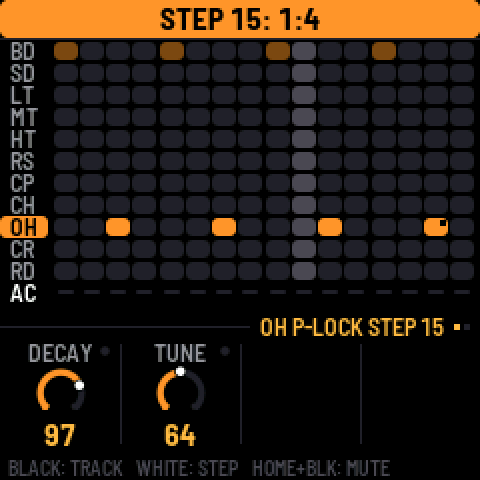
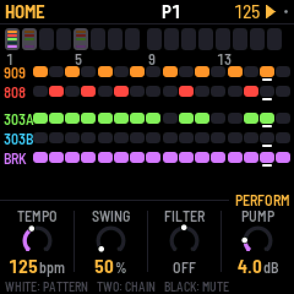
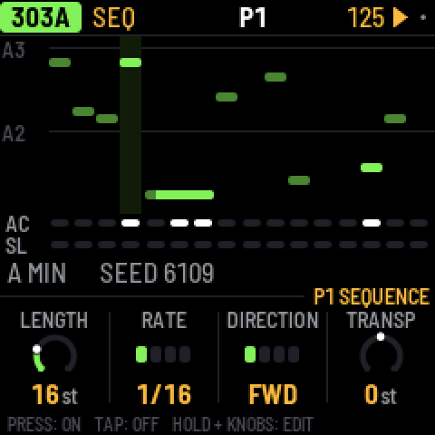
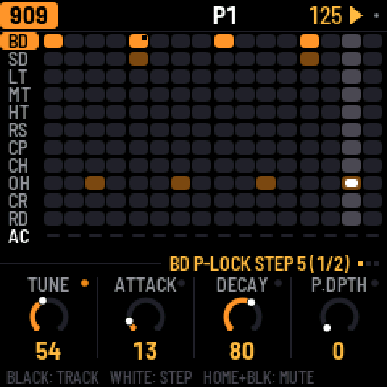
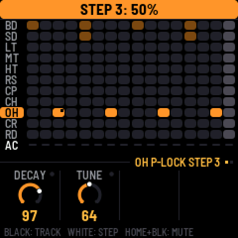
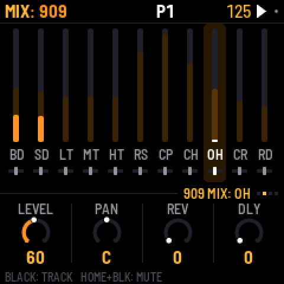
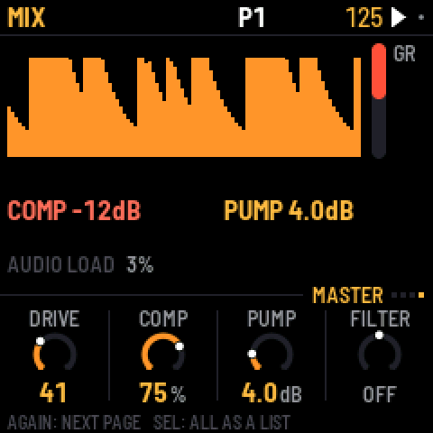
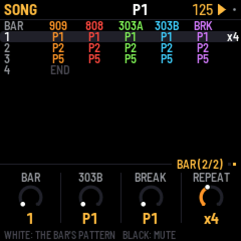

# What's new

The newest version first. Install it with the [web installer](../install/); the
[manual](../manual/) covers everything in detail.

## 1.2.0 · 1 November 2026

- Tap tempo. Hold HOME and tap SEQ in time, from any screen, playing or stopped. From the third tap
  in a row it sets the tempo and follows the last four taps; playing, each tap also puts the beat on
  your tap. One or two stray taps change nothing. Thanks @TomPeak.
- MIDI CC in and out. A controller turns X0X's knobs: each part on its own channel, the mixer, the
  effects and the master on MIX MIDI CH (1). The map is fixed and matches CTL-1's, so CTL-1 plays
  X0X as it comes. GLO > CC OUT sends the knobs you turn (KNOBS), or also what knob motion and p-locks
  play (ALL), never at the cost of a note. Section 16 of the manual has the map.
- A new reverb, ROOM: smoother and wider, with less fizz on low tails such as a tom's. It replaces the
  old one; your DECAY and TONE settings carry over. Thanks @luchak.
- PING WIDTH (FX, in SEL's list) sets how far apart ping-pong's echoes sit: 0 is off, 127 hard left
  and right, and between, closer together. A new project starts at 20. It replaces the PING-PONG
  switch. Thanks @luchak.
- Turning SWING while playing no longer pushes parts off the beat, and a random or reverse 303 with
  swing stays on its grid. Thanks @luchak.
- A BD's pan motion in a project from before 9 October now stays on the pan when it loads, instead of
  moving to the reverb send. Thanks @luchak.
- The 303, 909 and 808 use less of the processor for exactly the same sound, after Optimist's
  speed-ups (henri): the busiest test pattern's peak went from 102% to 99%.
- The installer takes M-VAVE's stock firmware V16 as well as V15.
- The emulator and the site's pages work with a screen reader and the keyboard.
- Releases are now built and signed on GitHub, so the Firmware Hub can check where a package came
  from. Thanks @keremimo.

## 1.1.0 · 15 October 2026

- X0X works with a screen reader. Plug the FM-1 into a computer and open the
  [FM-1 Screen Reader](https://charlesvestal.github.io/fm1-reader/) in Chrome or Edge. It reads out
  what the screen shows: each page and its knobs, a knob's value as you turn it, list rows with their
  place, help cards, questions, steps you put on or off, play and stop, and every message, in words
  ("bass drum tune 37"). It can speak with its own voice or pass the words to your own screen reader
  (VoiceOver, NVDA, JAWS). The FM-1 stays silent until the page connects, so a DAW never sees it.

## 1.0.9 · 15 October 2026

- A new [backup page](../backup/) saves your project to a file and puts it back, so you can keep several
  projects or try another firmware and come back. The FM-1 asks before a restore replaces anything.
  Break loops aren't included; load them again from their WAVs.
- The break has a filter. Press EDIT on the break and turn SELECT to SOUND. Turn FILTER left for a
  low-pass and right for a high-pass; the middle is off. A high-pass leaves a loop's hats under your own
  kick and snare.
- X0X runs the processor at 1.38 / 1.60V, the voltages M-VAVE's own firmware uses. Some FM-1s crashed
  with both cores at the lower voltages custom firmware inherited. GLO > PERFORMANCE shows them.
- After a crash, GLO > PERFORMANCE keeps its numbers in red until you switch off, so you can photograph
  them.
- A save cut off by switching off loads the save before it, instead of an empty project.

## 1.0.8 · 14 October 2026

- Hold ENV and turn a knob to put it back to its default.
- In safe mode, hold OCT- and OCT+ for 5 seconds to reach the update mode.
- GLO > 2ND CORE says AT THE NEXT POWER-ON when you change it.

## 1.0.7 · 14 October 2026

- GLO > 2ND CORE turns the second core on or off from the next start. It's on by default. If X0X
  crashes with both cores running, it turns the second core off by itself and carries on with one. After
  a crash while starting, it starts on one core, once.
- X0X raises one of the processor's supplies from 1.40V to 1.50V when it starts. At 1.40V, some FM-1s
  misread their memory when both cores are busy, and crash.
- Thanks to the testers who measured their FM-1s, and to Jangada and Melodee for theirs.

## 1.0.6 · 11 October 2026

- The 303s have free play. Press SEQ, turn SELECT to the KEYS page and set FREE PLAY to ON. The keys
  play the 303 on every 303 screen without writing anything, so you can try lines and shape the sound
  first; REC still records.
- The song plays from the SONG screen. Press PLAY there and the song plays from the selected bar, and
  keeps playing wherever you go. PLAY anywhere else plays the patterns. The MODE setting is gone.
- Set GLO > USB AUDIO to FULL to keep USB audio at full level whatever the MASTER knob says, so you can
  record over the cable with the speaker turned down. FOLLOWS KNOB is the default and works as before.
- GLO is in sections: MIDI, AUDIO, KEYS AND SCREEN, PROJECT, SYSTEM.

## 1.0.5 · 10 October 2026

- X0X checks the second processor core more sharply. On an FM-1 whose second core misreads, it now also
  catches the one misread 1.0.4 could miss, and carries on with one core. Nothing changes on an FM-1
  whose cores both work.

## 1.0.4 · 10 October 2026

- On FM-1s whose second processor core doesn't work reliably, X0X notices and carries on with one core,
  instead of clicking or stopping in the middle of an update. GLO > PERFORMANCE says 2 CORES, or
  1 CORE: BAD READS on such a unit. Thanks to Jangada's maintainer for the measurements and the fixes.
- A crash on the second core no longer freezes the FM-1.

## 1.0.3 · 10 October 2026

- GLO > BATTERY shows the battery's charge: FULL, 2/3, 1/3 or EMPTY, or USB POWER while a computer powers
  the FM-1.

## 1.0.2 · 10 October 2026

- Probability cycles count from the first pass again when the 909 changes pattern, as the other parts
  already did. Switch patterns and a 1:4 step plays on the new pattern's first bar.

## 1.0.1 · 10 October 2026

- A step's probability can be a cycle. Hold a step and turn SELECT down past 5% for 1:2, 2:2, 1:3 … 8:8.
  A step at 1:4 plays on the first of every four passes of its pattern, 2:4 on the second.

## 1.0 · 10 October 2026

### Highlights
- X0X uses both of the FM-1's processor cores, so there are no dropouts, even on the most complex patterns. The busiest test pattern went from about 115% to 68% load. Thanks @keremimo (Melodee)
- Navigation is simpler. HOME is for the pattern and song, SEQ for the selected part's steps, EDIT for its sound. Press a button again, or turn SELECT, for the next page.
- Screens are clearer. Each knob row says whose knobs they are, a hint line shows what the keys do, holding any button explains it, and labels are clearer throughout.
- Each part has up to 64 steps, and there are 32 patterns.
- A step can have p-locks and a probability. On EDIT, hold a step and turn a knob for a p-lock. Hold a step and turn SELECT for its probability.
- The drums have a mixer with per-track mutes, sends and hit meters.
- A new [break tool](../breaks/) loads and manages your own loops from the browser (BR1, BR2…).

### Sequencing
- 303 note entry is new. REC turns the keys into a keyboard, and ties show as one long note. Hold a step and press OCT to move it an octave.
- Hold SAVE and press a white key to copy and paste a whole pattern.
- Song bars can repeat, ×1 to ×8.
- A break step can have its own slice. Hold the step and press black keys 1–8.
- The break's COMPLEXITY now eases ROLL and FILL in gently.

### Sound and mix
- Both kicks have reverb and delay sends.
- The 909 snare has DECAY.
- The master has one-knob COMP and FILTER, and the MASTER page shows the output level.
- The factory reverb is calmer.
- OUTPUT LOUD is for quiet headphones.
- The 808's hats always choke like the 909's. The CHOKE setting is gone.

### MIDI
- Each part has a MIDI channel, in and out, or OFF.
- The tempo readout is steady when following an external clock.

### Feel and fixes
- Knobs no longer miss or double clicks, and small turns are exact.
- Key lights have two brightness levels. A chosen key is bright, an available one dim.
- Saving waits until you stop, so the audio never cuts out.
- B CHANCE works without PHRASE.
- CLEAR PATTERN no longer leaves a bar showing on HOME.
- The keys no longer trigger steps or slices on the MASTER and FX screens.

Projects saved with 0.10 load as they were.

## Earlier versions

0.10.3-beta · 8 October 2026

- PLAY is green. It uses its green light, and turns red only while recording (REC on). Its glow is green too.

0.10.2-beta · 8 October 2026

- The buttons can be read in the dark. The buttons that aren't lit now glow dimly, so their labels can be read on the black FM-1. The KEY LIGHTS setting is now LIGHTS. ON shows the key lights and the glow, KEYS shows the key lights only, and OFF neither. ON is the default, and a saved "on" becomes ON.
- The performance page also reports how deep the interrupts' stack has gone.

0.10.1-beta · 6 October 2026

- Turning volume, pan or the sends quickly no longer zippers. Part volume, pan and sends, the master volume and every drum voice's pan now glide over about 10 ms instead of jumping.

0.10-beta · 6 October 2026

- This fixes the brightness freeze. Setting BRIGHTNESS low could freeze the FM-1, and it then stayed stuck at the boot screen (dim, no input) even after reinstalling. The setting is gone, a saved value is ignored, and the screen is always at full brightness. If your FM-1 is stuck, install 0.10-beta from the web installer.
- X0X is stereo. Every part has a PAN on its SENDS page or on MIX > PANS, and so does every 909 voice and 808 track (the last setting on its page). With everything centred it sounds exactly as before.
- The reverb is stereo, and the delay can ping-pong. The ping-pong delay is PING on the FX TAPE page; delay times over one second stay centred.
- TRS MIDI IN takes notes, clock and transport from the TRS jack, the same as over USB.

0.9-beta · 5 October 2026

- Over USB, the FM-1 shows up on a computer as a 44.1 kHz audio input ("X0X FM-1"), with no driver. It is resampled to the computer's USB clock, so live monitoring (an AU host, a DAW) doesn't drift or drop out.
- USB MIDI clock and transport are fixed. Clock, Start, Stop and Continue sent over USB were ignored; X0X now follows a DAW's clock and transport.
- Busy patterns drop out less. Audio renders in 11.6 ms blocks, so a heavy step no longer overruns. This adds 5.8 ms of latency.
- 808 voices stop once their tail is 60 dB under the hit, saving CPU without changing what you hear.
- On the 303, holding a step no longer toggles it; only a tap does. Holding or editing a step follows KEY SOUND like the drum keys, so it's silent while the pattern plays.
- On TB-3PO, the GENERATE and SCALE knobs no longer rewrite the line. They set up the next OCT+ (new line) or OCT- (mutate). The screen marks changed settings with a star.

0.8-beta · 5 October 2026

- Fast knob turns count. A quick flick no longer gets lost, because the encoder decoder keeps up with skipped states.
- X0X has an overload guard. When the FM-1 nears its CPU limit, the 303s drop oversampling and the 808's tails end sooner instead of dropping out. GUARD shows next to the audio load, and the performance page counts how often it engaged.
- The screen tears less. The display runs at 60 MHz, the main area sends only what changed, and both halves change together. Some tearing remains, because the FM-1 has no tearing-sync line.

0.7-beta · 5 October 2026

- Knobs accelerate by speed. Turn slowly for single steps, quickly to sweep; a fast half turn covers the whole range.
- GLO > BRIGHTNESS sets the screen's brightness, 1 to 8.
- tools/upload_breaks.py no longer crashes when given more loops than fit, and retries a write the USB link lost.

0.6-beta · 5 October 2026

- Knobs and LEDs keep up under load. The key/knob/LED matrix scan now keeps its rhythm while the audio renders. Fast knob turns no longer lose their steps, and the LEDs no longer flicker with the audio load. (Found on the first hardware run.)

0.5-beta · 5 October 2026

- Hold HOME and press REC to undo, or PLAY to redo, up to 32 steps. Undo covers sounds, patterns, the song and knob motion, CLEAR PATTERN and FACTORY RESET included. The screen says what was undone.
- GLO > AUTOSAVE is on by default. While stopped, changes save themselves after 4 s of quiet. Saves now write only what changed.
- Hold any button for a second and a help card shows what it does on the current screen, with its combinations.
- After two failed starts, X0X starts in safe mode with no sound and USB on, so the web installer can always reach it. It used to drop into the chip's update mode, which no installer can see. PLAY tries again.
- After a crash, the next start says so and shows where.
- The web installer can put M-VAVE's stock firmware (FM-1 V15) back.
- The browser version can load your own breaks.

0.4-beta · 4 October 2026

- Black drum keys select silently while the pattern plays. They still sound when stopped and with REC on. This is the new GLO > KEY SOUND, STOPPED by default; ALWAYS keeps the old behaviour.
- The 303 lines start empty, like the drums. A fresh FM-1 (or FACTORY RESET) no longer plays two generated lines. OCT+ on TB-3PO writes one. Saved projects are unchanged.
- A delay division longer than the 2 s line (1/2. below 90 BPM, 1/2 below 60) now halves and stays on the beat instead of being cut off the grid.
- GLO > ABOUT shows the real version (every release said 0.1).
- X0X runs in the browser, at https://charlesvestal.github.io/fm1-x0x/emu/
- The manual's Troubleshooting section is new. It explains how to recover an FM-1 that won't start, from a Mac.

0.3-beta · 4 October 2026

- X0X no longer crashes on hardware with the "X0X CRASH" screen soon after start. A divide-by-zero trap fired in the master limiter. The trap is off and the divide is clamped.
- It includes the PERFORMANCE screen and PERF TEST in the GLO menu from 0.2-beta.

0.2-beta · 4 October 2026

It still has not run on a real FM-1. This build measures itself, so the first install tells us what the FM-1 can do. Installing is at your own risk; M-VAVE's updater (M-UPGRADE) puts the official firmware back.

Please run the performance test. Open GLO > PERFORMANCE, then SEL > RUN PERF TEST. It plays three built-in patterns for about 15 seconds, puts your project back as it was, and shows a table. A photo of that screen is the most useful thing you can send.

- Install: https://charlesvestal.github.io/fm1-x0x/install/
- Manual: https://charlesvestal.github.io/fm1-x0x/manual/

Changes since 0.1-beta:
- The PERFORMANCE page shows the clock, audio load and peak, dropouts, and each part's share of the CPU. It has RUN PERF TEST.
- A new big-beat factory mix has the break up front, the 909 kick under it, RAT 303s into tape delay, and a pumping master.
- The kick no longer clicks. The 909 kick's attack is back to 9W9's, the pump eases in, and there's a look-ahead limiter.
- The engines are cheaper. Silent parts are skipped, the master is lighter, tanh is faster, and the RAT clipper has no square roots or divides.
- The manual is rewritten in plain sentences, with a Getting started tour.

0.1-beta · 4 October 2026

First public build. It has not yet run on a real FM-1, so the first people to install it are the first test. Installing is at your own risk; M-VAVE's updater (M-UPGRADE) puts the official firmware back.

- Install: https://charlesvestal.github.io/fm1-x0x/install/ (Chrome or Edge, the FM-1 on USB), or `python3 tools/fm1_install.py x0x-0.1-beta.fwsc` with the file below.
- Manual: https://charlesvestal.github.io/fm1-x0x/manual/

What's in it:
- A 909 (from 9W9 / ER-99) and an 808 (from 8W8), eleven tracks each
- Two 303s (from schwung-303 / Open303), each with a TB-3PO line generator
- A breakbeat generator (from BB Gen); load your own breaks with `tools/upload_breaks.py`
- 16 patterns, each part on its own pattern; a song mode; recorded knob moves
- Reverb and tape delay sends on every part; a master compressor with kick-keyed pump, a filter and a limiter
- A big-beat factory mix

